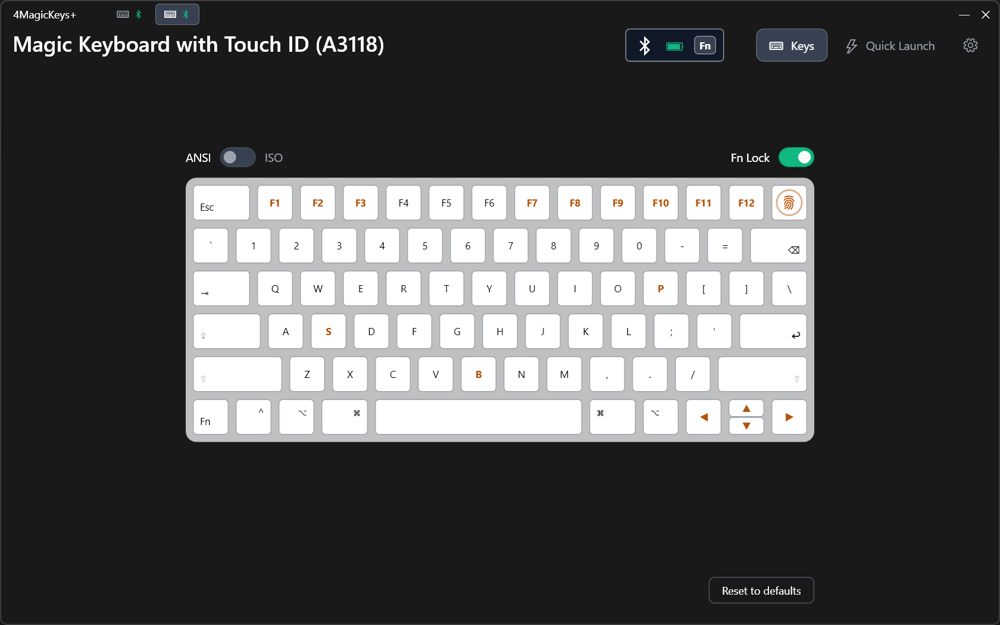

# 4MagicKeys+

Windows driver and apps for Apple Magic Keyboards. They make the keyboard behave like a Windows one: any key can be remapped, the Fn layer gives Home, End, Page Up/Down, Insert and Print Screen, the F-row works as media keys or as function keys, and a notice warns when the battery runs low. Every keyboard has settings of its own, the same over USB and over Bluetooth.



Originally forked and inspired by the [samartzidis/winAppleKey](https://github.com/samartzidis/winAppleKey) repository.

<details>
<summary><b>Supported keyboards</b></summary>

| Model | Name | Connection | Tested on hardware |
|-------|------|------------|--------------------|
| A1644 | Apple Magic Keyboard | USB / Bluetooth | Yes (by the author of the original project) |
| A1843 | Apple Magic Keyboard with Numeric Keypad | USB / Bluetooth | Yes |
| A2449 | Apple Magic Keyboard with Touch ID | USB / Bluetooth | No |
| A2450 | Apple Magic Keyboard with Lock Key | USB / Bluetooth | No |
| A2520 | Apple Magic Keyboard with Touch ID and Numeric Keypad | USB / Bluetooth | No |
| A3118 | Apple Magic Keyboard with Touch ID | USB / Bluetooth | Yes |
| A3119 | Apple Magic Keyboard with Touch ID and Numeric Keypad | USB / Bluetooth | No |
| A3203 | Apple Magic Keyboard with Lock Key | USB / Bluetooth | No |

A model marked No is supported on the strength of what is known about it (its product ID and the layout of its keys), but nobody has tried it on a real keyboard yet. If you have one, please tell how it goes in an issue.

</details>

## Features

- Remap any key to another key, swap modifiers, turn Fn, Eject or Lock into a key or a modifier, and turn a key into a modifier combination or a media, volume or brightness action.
- An Fn layer with rules of its own, and Fn Lock: the F-row keys work as media keys or as function keys, and Fn flips them.
- Settings per keyboard, the same over USB and over Bluetooth. Each model starts with defaults.
- A configuration app that shows the connected keyboards and edits their rules on a picture of the keyboard, with a dark and a light theme and a choice of language.
- An agent that starts programs on hotkeys and warns when the battery of a keyboard is low.

How it all works is in the [wiki](https://github.com/4teos/4MagicKeysPlus/wiki).

## Requirements

Windows 11 24H2 or newer, x64. Installing the driver and starting the configuration app need administrator rights.

## Installation

**DISCLAIMER:** The driver is signed with a self-signed (test) certificate that `sign.cmd` makes on your computer. Windows will not allow the driver installation unless running in **TESTSIGNING** mode. Permanently running Windows in TESTSIGNING mode leaves your system open to potential security risks. Any consequence is solely your own responsibility. 4MagicKeys+ is ***free software*** that you build and/or use completely ***at your own risk.*** If your system runs UEFI with **Secure Boot** enabled, you will need to disable **Secure Boot** in BIOS first.

### From the release archive

1. Enable TESTSIGNING mode (Administrative command prompt), then reboot:

   ```
   bcdedit.exe -set TESTSIGNING ON
   ```

2. Download `4MagicKeysPlus-<version>-win-x64.zip` from [Releases](https://github.com/4teos/4MagicKeysPlus/releases) and unpack it, keeping its folders as they are.
3. Start `sign.cmd`. It signs the driver and the agent on your computer, with a certificate that it makes and that Windows then trusts.
4. Install the driver via Device Manager: find your Apple keyboard under **Human Interface Devices**, right-click → **Update driver** → **Browse my computer** → **Let me pick from a list** → **Have Disk...**, and point to the `driver` folder.
5. Copy the `app` folder to a folder of its own under `C:\Program Files`, for example `C:\Program Files\4MagicKeysPlus` (the commands below use that one). It has to be in Program Files: Windows lets the agent receive hotkeys over elevated windows only when it is signed and in a protected folder.
6. Put the default settings of the keyboard models into the registry (Administrative command prompt):

   ```
   start /wait "" "C:\Program Files\4MagicKeysPlus\4MagicKeysPlus.exe" --install-defaults
   ```

7. Reconnect the keyboard, and start `4MagicKeysPlus.exe` from that folder.

Checking the download, updating and uninstalling are described on the [Installation](https://github.com/4teos/4MagicKeysPlus/wiki/Installation) page of the wiki.

## Uninstallation

Keep the order. The driver is registered as a filter on every keyboard device it was installed for, so when its registry key or its file is deleted while a keyboard still lists it, Windows cannot start that keyboard.

1. Close the configuration app and the agent (Task Manager → `4MagicKeysPlusAgent` → End task). Turn **Start with Windows** off on the Settings screen of the app first.
2. Take the driver off the keyboards (PowerShell as administrator). This removes the entry that the driver added to each keyboard device, also for keyboards that are not connected now, and prints the devices it changed:

   ```powershell
   $roots = 'HKLM:\SYSTEM\CurrentControlSet\Enum\HID', 'HKLM:\SYSTEM\CurrentControlSet\Enum\BTHENUM', 'HKLM:\SYSTEM\CurrentControlSet\Enum\USB'
   Get-ChildItem $roots -Recurse | ForEach-Object {
       $filters = (Get-ItemProperty -LiteralPath $_.PSPath).LowerFilters
       if ($filters -contains '4MagicKeysPlus') {
           $others = @($filters | Where-Object { $_ -notin 'vhf', '4MagicKeysPlus' })
           if ($others) { Set-ItemProperty -LiteralPath $_.PSPath -Name LowerFilters -Value ([string[]]$others) } else { Remove-ItemProperty -LiteralPath $_.PSPath -Name LowerFilters }
           $_.Name
       }
   }
   ```

3. Remove the driver packages from the driver store (PowerShell as administrator). Every version that was installed is a package of its own, and Windows gives each one a name of its own (`oemNN.inf`, the number differs from computer to computer), so this finds them by the original name of the file, `4magickeysplus.inf`, and deletes them all:

   ```powershell
   Get-WindowsDriver -Online | Where-Object { $_.OriginalFileName -like '*\4magickeysplus.inf' } | ForEach-Object { pnputil /delete-driver $_.Driver /uninstall /force }
   ```

4. Turn TESTSIGNING off (skip this if you need it for something else) and restart the computer. The keyboards work with the Windows drivers again.

   ```
   bcdedit.exe -set TESTSIGNING OFF
   ```

5. After the restart delete what is left of 4MagicKeys+ (Administrative command prompt):

   | What | Where |
   |------|-------|
   | the service of the driver, with the settings of all keyboards under it: profiles (`Parameters\Keyboards`), default settings (`Parameters\Defaults`) and launch entries (`Parameters\Hotkeys`) | `HKLM\SYSTEM\CurrentControlSet\Services\4MagicKeysPlus` |
   | the driver file, if it is still there | `C:\Windows\System32\drivers\4MagicKeysPlus.sys` |
   | the apps | `C:\Program Files\4MagicKeysPlus`, or the folder under Program Files that you chose |
   | the signing key and its `README.txt` | `C:\ProgramData\4MagicKeysPlusSigning` |
   | the signing certificate `CN=4MagicKeysPlus local signing` | the Local Machine stores **Trusted Root Certification Authorities** and **Trusted Publishers** |

   ```
   reg delete "HKLM\SYSTEM\CurrentControlSet\Services\4MagicKeysPlus" /f
   del "%SystemRoot%\System32\drivers\4MagicKeysPlus.sys"
   rd /s /q "C:\Program Files\4MagicKeysPlus"
   rd /s /q "C:\ProgramData\4MagicKeysPlusSigning"
   powershell -NoProfile -Command "Get-ChildItem Cert:\LocalMachine\Root, Cert:\LocalMachine\TrustedPublisher | Where-Object Subject -eq 'CN=4MagicKeysPlus local signing' | Remove-Item"
   ```

6. For every Windows user who started the app or the agent, in a command prompt of that user: the settings of the app, the autostart entries and the agent log.

   ```
   reg delete "HKCU\Software\4MagicKeysPlus" /f
   reg delete "HKCU\Software\Microsoft\Windows\CurrentVersion\Run" /v 4MagicKeysPlusAgent /f
   reg delete "HKCU\Software\Microsoft\Windows\CurrentVersion\Explorer\StartupApproved\Run" /v 4MagicKeysPlusAgent /f
   rd /s /q "%LOCALAPPDATA%\4MagicKeysPlus"
   ```

The unpacked release archive and the downloaded zip are ordinary files, delete them wherever they are.

## Building and contributing

Building from source, the layout of the repository, the tests and how a release is made are in the [wiki](https://github.com/4teos/4MagicKeysPlus/wiki): see [Building from Source](https://github.com/4teos/4MagicKeysPlus/wiki/Building-from-Source) and [Contributing](https://github.com/4teos/4MagicKeysPlus/wiki/Contributing).

## Thanks

Big shout out to [gozaltech/mkBatteryChecker](https://github.com/gozaltech/mkBatteryChecker) and [hank1101444/WinMagicBattery](https://github.com/hank1101444/WinMagicBattery), which showed how the battery level of a Magic Keyboard can be read.

## License

[MIT](LICENSE).

Apple and Magic Keyboard are trademarks of Apple Inc. 4MagicKeys+ is an independent project and is not affiliated with or endorsed by Apple.
